  

<h1 align="center">Hi 👋 I'm Arda</h1>
<h3 align="center">Computer Engineering Student · Software Developer </h3>

<picture>
  <source media="(prefers-color-scheme: dark)" srcset="dist/github-snake-dark.svg" />
  <source media="(prefers-color-scheme: light)" srcset="dist/github-snake.svg" />
  
</picture>

  
  
  

---

## 🧙 Character Sheet

> Profilim bir anime RPG karakteri: seviyem commit, yıldız, repo ve takipçi sayımdan hesaplanıyor. Kart her gün otomatik güncelleniyor.

  

---

## 👋 About Me

I'm a **Computer Engineering student** who enjoys building things that actually work and feel good to use.

- 📱 Developing clean and modern **Mobile apps** with **React Native** and **Jetpack Compose**
- 🤖 Experimenting with **AI, Machine Learning, LLMs, and AI agents**
- 🌐 Building backend & web systems with **FastAPI**, **React**, and real-time technologies
- 🧠 Learning by building — especially in areas like **multimodal AI** and **agent-based systems**

---

## 🛠️ Tech Stack

	<code></code>
	<code></code>
	<code></code>
	<code></code>
	<code></code>
	<code></code>
	<code></code>
	<code></code>
	<code></code>
	<code></code>
	<code></code>
	<code></code>
	<code></code>
	<code></code>
	<code></code>

---

## 📌 Featured Projects

Some projects I really enjoyed working on:

- 🎮 **Lexo**  
  A real-time multiplayer word game built with **React**, **FastAPI**, and **WebSockets**. Focused on performance and competitive gameplay.

- 🎼 **Audify**  
  An agent-based AI application that turns images and videos into emotionally-driven music using **LangGraph**, **Streamlit**, and multimodal models.

- 🎧 **Text-to-Music-Image**  
  A creative AI project that generates music from text or visual prompts.

- 🐦 **Indian Bird Species Classification**  
  A CNN-based image classification system trained on 25 bird species.

- 📈 **Stock Price Forecasting (LSTM)**  
  Time-series forecasting using LSTM networks to analyze market trends.

- 👽 **Rick and Morty App**  
  A simple and clean Android app consuming the Rick and Morty API with **Kotlin**.

---

## 👾 Boss Fight

> Her ziyaretçi savaşabilir! **SALDIR** linkine tıkla, açılan issue'yu oluştur; bir bot hasarını hesaplayıp boss'un canını düşürür. Boss ölünce daha güçlüsü gelir.

<!--START_SECTION:boss-->

<a href="https://github.com/ardacey/ardacey/issues/new?title=boss%3A%20attack&body=Sadece%20asagidaki%20%27Create%27%20/%20%27Submit%20new%20issue%27%20butonuna%20bas.%20Gerisini%20bot%20halleder."><b>⚔️ SALDIR!</b></a> · linke tıkla → açılan issue'da <i>Create</i>'e bas → birkaç saniye içinde hasarın README'ye yansır

<!--END_SECTION:boss-->

---

## ♟️ Satranç Oyna

> Herkesin oynadığı tek bir oyun var. Sırası gelen tarafın hamlesini sen yap; tahta otomatik güncellenir. Üst üste iki hamle yapamazsın, bir arkadaşını çağır!

<!--START_SECTION:chess-->

**Sıra: ⚪ Beyaz** · Oynanan hamle: 0 · Biten oyun: 0

<b>♟️ Hamle yap (20 legal hamle)</b>

Bir hamleye tıkla → açılan issue'da **Create**'e bas.

| Taş | Gidebileceği kareler |
|---|---|
| ♙ a2 | [a3](https://github.com/ardacey/ardacey/issues/new?title=chess%3A%20a2a3&body=Sadece%20asagidaki%20%27Create%27%20/%20%27Submit%20new%20issue%27%20butonuna%20bas.%20Gerisini%20bot%20halleder.) · [a4](https://github.com/ardacey/ardacey/issues/new?title=chess%3A%20a2a4&body=Sadece%20asagidaki%20%27Create%27%20/%20%27Submit%20new%20issue%27%20butonuna%20bas.%20Gerisini%20bot%20halleder.) |
| ♘ b1 | [c3](https://github.com/ardacey/ardacey/issues/new?title=chess%3A%20b1c3&body=Sadece%20asagidaki%20%27Create%27%20/%20%27Submit%20new%20issue%27%20butonuna%20bas.%20Gerisini%20bot%20halleder.) · [a3](https://github.com/ardacey/ardacey/issues/new?title=chess%3A%20b1a3&body=Sadece%20asagidaki%20%27Create%27%20/%20%27Submit%20new%20issue%27%20butonuna%20bas.%20Gerisini%20bot%20halleder.) |
| ♙ b2 | [b3](https://github.com/ardacey/ardacey/issues/new?title=chess%3A%20b2b3&body=Sadece%20asagidaki%20%27Create%27%20/%20%27Submit%20new%20issue%27%20butonuna%20bas.%20Gerisini%20bot%20halleder.) · [b4](https://github.com/ardacey/ardacey/issues/new?title=chess%3A%20b2b4&body=Sadece%20asagidaki%20%27Create%27%20/%20%27Submit%20new%20issue%27%20butonuna%20bas.%20Gerisini%20bot%20halleder.) |
| ♙ c2 | [c3](https://github.com/ardacey/ardacey/issues/new?title=chess%3A%20c2c3&body=Sadece%20asagidaki%20%27Create%27%20/%20%27Submit%20new%20issue%27%20butonuna%20bas.%20Gerisini%20bot%20halleder.) · [c4](https://github.com/ardacey/ardacey/issues/new?title=chess%3A%20c2c4&body=Sadece%20asagidaki%20%27Create%27%20/%20%27Submit%20new%20issue%27%20butonuna%20bas.%20Gerisini%20bot%20halleder.) |
| ♙ d2 | [d3](https://github.com/ardacey/ardacey/issues/new?title=chess%3A%20d2d3&body=Sadece%20asagidaki%20%27Create%27%20/%20%27Submit%20new%20issue%27%20butonuna%20bas.%20Gerisini%20bot%20halleder.) · [d4](https://github.com/ardacey/ardacey/issues/new?title=chess%3A%20d2d4&body=Sadece%20asagidaki%20%27Create%27%20/%20%27Submit%20new%20issue%27%20butonuna%20bas.%20Gerisini%20bot%20halleder.) |
| ♙ e2 | [e3](https://github.com/ardacey/ardacey/issues/new?title=chess%3A%20e2e3&body=Sadece%20asagidaki%20%27Create%27%20/%20%27Submit%20new%20issue%27%20butonuna%20bas.%20Gerisini%20bot%20halleder.) · [e4](https://github.com/ardacey/ardacey/issues/new?title=chess%3A%20e2e4&body=Sadece%20asagidaki%20%27Create%27%20/%20%27Submit%20new%20issue%27%20butonuna%20bas.%20Gerisini%20bot%20halleder.) |
| ♙ f2 | [f3](https://github.com/ardacey/ardacey/issues/new?title=chess%3A%20f2f3&body=Sadece%20asagidaki%20%27Create%27%20/%20%27Submit%20new%20issue%27%20butonuna%20bas.%20Gerisini%20bot%20halleder.) · [f4](https://github.com/ardacey/ardacey/issues/new?title=chess%3A%20f2f4&body=Sadece%20asagidaki%20%27Create%27%20/%20%27Submit%20new%20issue%27%20butonuna%20bas.%20Gerisini%20bot%20halleder.) |
| ♘ g1 | [h3](https://github.com/ardacey/ardacey/issues/new?title=chess%3A%20g1h3&body=Sadece%20asagidaki%20%27Create%27%20/%20%27Submit%20new%20issue%27%20butonuna%20bas.%20Gerisini%20bot%20halleder.) · [f3](https://github.com/ardacey/ardacey/issues/new?title=chess%3A%20g1f3&body=Sadece%20asagidaki%20%27Create%27%20/%20%27Submit%20new%20issue%27%20butonuna%20bas.%20Gerisini%20bot%20halleder.) |
| ♙ g2 | [g3](https://github.com/ardacey/ardacey/issues/new?title=chess%3A%20g2g3&body=Sadece%20asagidaki%20%27Create%27%20/%20%27Submit%20new%20issue%27%20butonuna%20bas.%20Gerisini%20bot%20halleder.) · [g4](https://github.com/ardacey/ardacey/issues/new?title=chess%3A%20g2g4&body=Sadece%20asagidaki%20%27Create%27%20/%20%27Submit%20new%20issue%27%20butonuna%20bas.%20Gerisini%20bot%20halleder.) |
| ♙ h2 | [h3](https://github.com/ardacey/ardacey/issues/new?title=chess%3A%20h2h3&body=Sadece%20asagidaki%20%27Create%27%20/%20%27Submit%20new%20issue%27%20butonuna%20bas.%20Gerisini%20bot%20halleder.) · [h4](https://github.com/ardacey/ardacey/issues/new?title=chess%3A%20h2h4&body=Sadece%20asagidaki%20%27Create%27%20/%20%27Submit%20new%20issue%27%20butonuna%20bas.%20Gerisini%20bot%20halleder.) |

<!--END_SECTION:chess-->

---

  
  

  

---

## 🌍 Connect With Me

- 💼 **LinkedIn:** https://www.linkedin.com/in/arda-ceylan/
- 📧 **Email:** ac.ardaceylan@gmail.com

---

Happy coding! ✨
