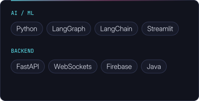
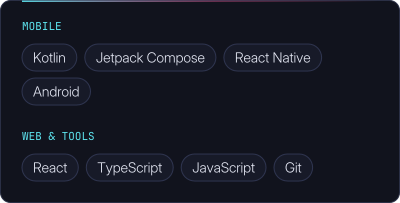
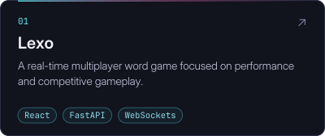
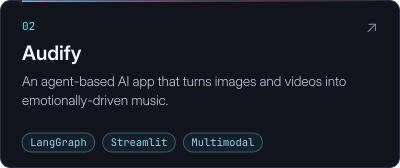
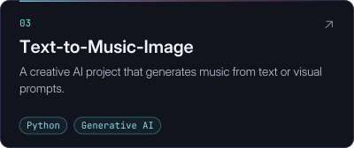
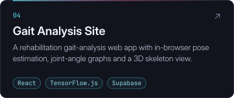
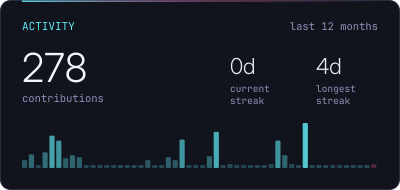
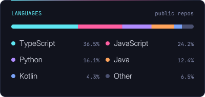

  <picture>
    <source media="(max-width: 600px)" srcset="assets/banner-mobile.svg" />
    
  </picture>

<h1 align="center">Hi 👋 I'm Arda</h1>

  

<!-- LIGHTS:START -->

121 windows lit by <a href="https://github.com/ghostworker13">@ghostworker13</a>, <a href="https://github.com/arpitrajjj">@arpitrajjj</a>, <a href="https://github.com/shinobi-coder701">@shinobi-coder701</a>, <a href="https://github.com/MJ-ulia">@MJ-ulia</a>, <a href="https://github.com/dejaadre-boop">@dejaadre-boop</a> and 116 more · <a href="https://github.com/ardacey">follow</a> or <a href="https://github.com/ardacey/ardacey">⭐ star</a> to light yours

<!-- LIGHTS:END -->

  
  
  

<picture>
  <source media="(max-width: 600px) and (prefers-color-scheme: dark)" srcset="assets/headers/about-dark-mobile.svg" />
  <source media="(max-width: 600px)" srcset="assets/headers/about-light-mobile.svg" />
  <source media="(prefers-color-scheme: dark)" srcset="assets/headers/about-dark.svg" />
  
</picture>

I'm a **Software Engineer** who enjoys building things that actually work and feel good to use.

- Developing clean and modern **Mobile apps** with **React Native** and **Jetpack Compose**
- Experimenting with **AI, Machine Learning, LLMs, and AI agents**
- Building backend & web systems with **FastAPI**, **React**, and real-time technologies
- Learning by building — especially in areas like **multimodal AI** and **agent-based systems**

<picture>
  <source media="(max-width: 600px) and (prefers-color-scheme: dark)" srcset="assets/headers/stack-dark-mobile.svg" />
  <source media="(max-width: 600px)" srcset="assets/headers/stack-light-mobile.svg" />
  <source media="(prefers-color-scheme: dark)" srcset="assets/headers/stack-dark.svg" />
  
</picture>

  
  

<picture>
  <source media="(max-width: 600px) and (prefers-color-scheme: dark)" srcset="assets/headers/projects-dark-mobile.svg" />
  <source media="(max-width: 600px)" srcset="assets/headers/projects-light-mobile.svg" />
  <source media="(prefers-color-scheme: dark)" srcset="assets/headers/projects-dark.svg" />
  
</picture>

Some projects I really enjoyed working on:

  
  

  
  

<picture>
  <source media="(max-width: 600px) and (prefers-color-scheme: dark)" srcset="assets/headers/stats-dark-mobile.svg" />
  <source media="(max-width: 600px)" srcset="assets/headers/stats-light-mobile.svg" />
  <source media="(prefers-color-scheme: dark)" srcset="assets/headers/stats-dark.svg" />
  
</picture>

  
  

<picture>
  <source media="(max-width: 600px) and (prefers-color-scheme: dark)" srcset="assets/headers/connect-dark-mobile.svg" />
  <source media="(max-width: 600px)" srcset="assets/headers/connect-light-mobile.svg" />
  <source media="(prefers-color-scheme: dark)" srcset="assets/headers/connect-dark.svg" />
  
</picture>

- **LinkedIn:** https://www.linkedin.com/in/arda-ceylan/
- **Email:** ac.ardaceylan@gmail.com

---

Happy coding! ✨
