  

<h1 align="center">Hi 👋 I'm Arda</h1>

<picture>
  <source media="(prefers-color-scheme: dark)" srcset="dist/github-snake-dark.svg" />
  <source media="(prefers-color-scheme: light)" srcset="dist/github-snake.svg" />
  
</picture>

  
  
  

<picture>
  <source media="(prefers-color-scheme: dark)" srcset="assets/headers/about-dark.svg" />
  
</picture>

I'm a **Software Engineer** who enjoys building things that actually work and feel good to use.

- Developing clean and modern **Mobile apps** with **React Native** and **Jetpack Compose**
- Experimenting with **AI, Machine Learning, LLMs, and AI agents**
- Building backend & web systems with **FastAPI**, **React**, and real-time technologies
- Learning by building — especially in areas like **multimodal AI** and **agent-based systems**

<picture>
  <source media="(prefers-color-scheme: dark)" srcset="assets/headers/stack-dark.svg" />
  
</picture>

	<code></code>
	<code></code>
	<code></code>
	<code></code>
	<code></code>
	<code></code>
	<code></code>
	<code></code>
	<code></code>
	<code></code>
	<code></code>
	<code></code>
	<code></code>
	<code></code>
	<code></code>

<picture>
  <source media="(prefers-color-scheme: dark)" srcset="assets/headers/projects-dark.svg" />
  
</picture>

Some projects I really enjoyed working on:

- **Lexo**  
  A real-time multiplayer word game built with **React**, **FastAPI**, and **WebSockets**. Focused on performance and competitive gameplay.

- **Audify**  
  An agent-based AI application that turns images and videos into emotionally-driven music using **LangGraph**, **Streamlit**, and multimodal models.

- **Text-to-Music-Image**  
  A creative AI project that generates music from text or visual prompts.

- **Indian Bird Species Classification**  
  A CNN-based image classification system trained on 25 bird species.

- **Stock Price Forecasting (LSTM)**  
  Time-series forecasting using LSTM networks to analyze market trends.

- **Rick and Morty App**  
  A simple and clean Android app consuming the Rick and Morty API with **Kotlin**.

<picture>
  <source media="(prefers-color-scheme: dark)" srcset="assets/headers/stats-dark.svg" />
  
</picture>

  
  

  

<picture>
  <source media="(prefers-color-scheme: dark)" srcset="assets/headers/connect-dark.svg" />
  
</picture>

- **LinkedIn:** https://www.linkedin.com/in/arda-ceylan/
- **Email:** ac.ardaceylan@gmail.com

---

Happy coding! ✨
